# แผนภาพสำหรับสอนและส่งตรวจ

เปิด [BPES-design.drawio](BPES-design.drawio) ด้วย Draw.io Desktop มี 11 หน้าที่แก้ไขได้ SVG ใช้เปิดดูออฟไลน์ใน browser

## 01-login

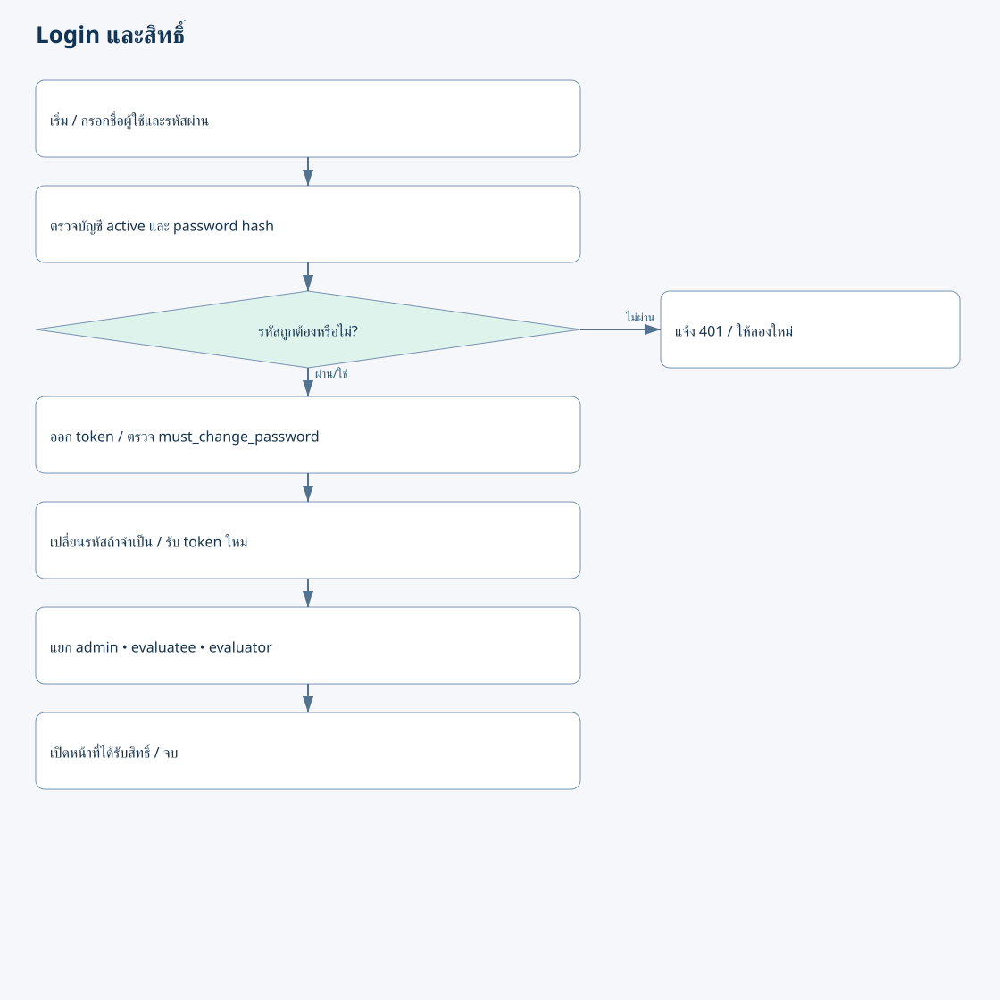

## 02-admin

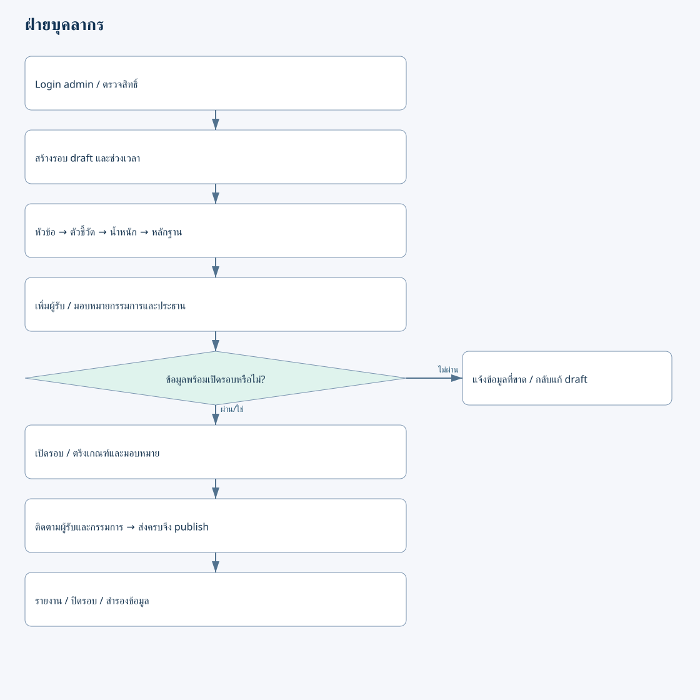

## 03-self

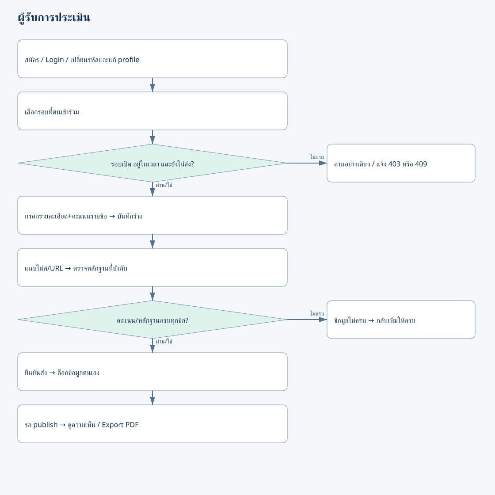

## 04-evaluator

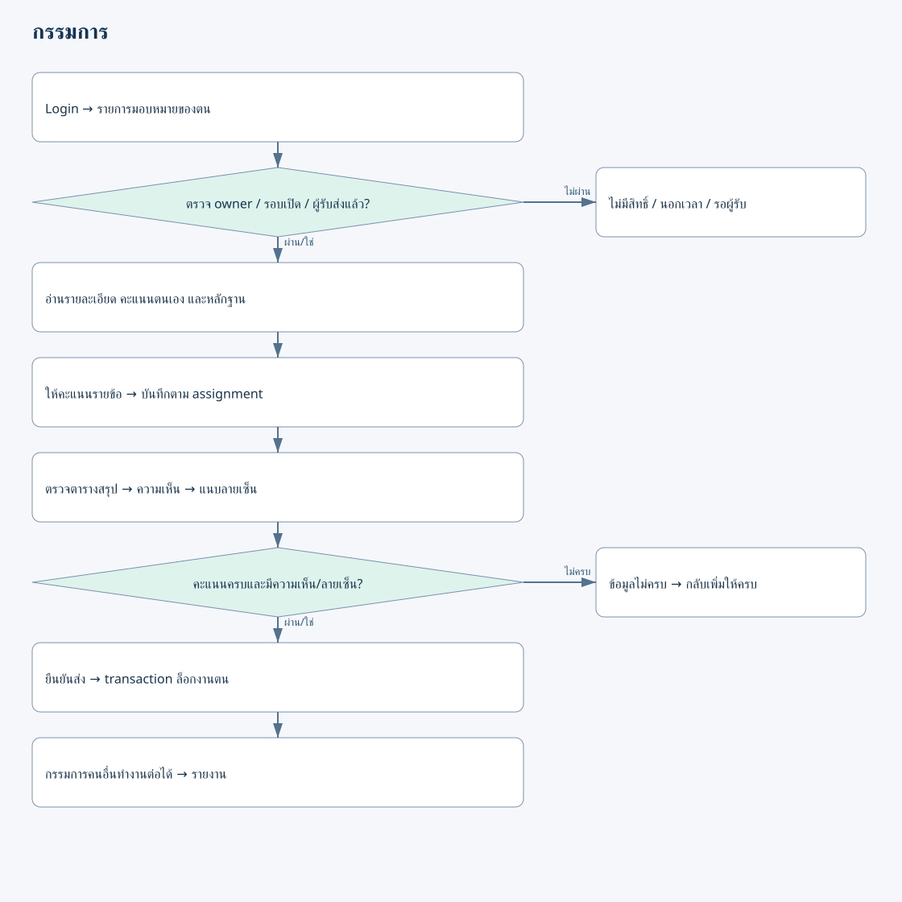

## 05-overview

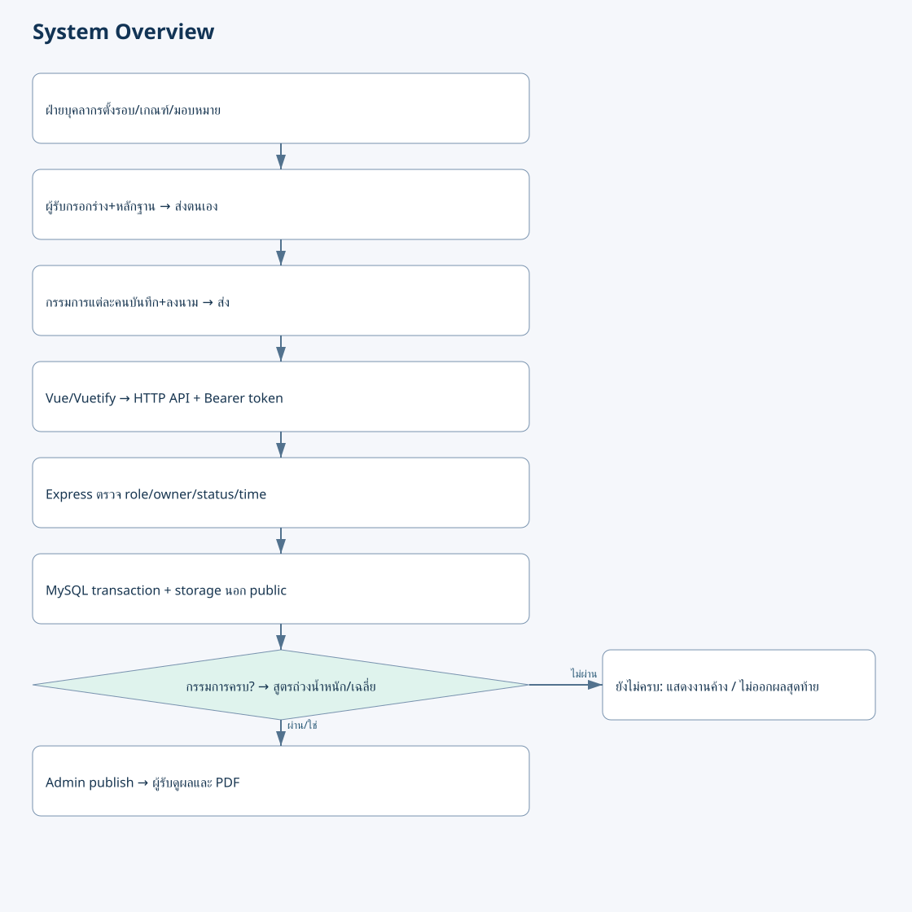

## 06-er

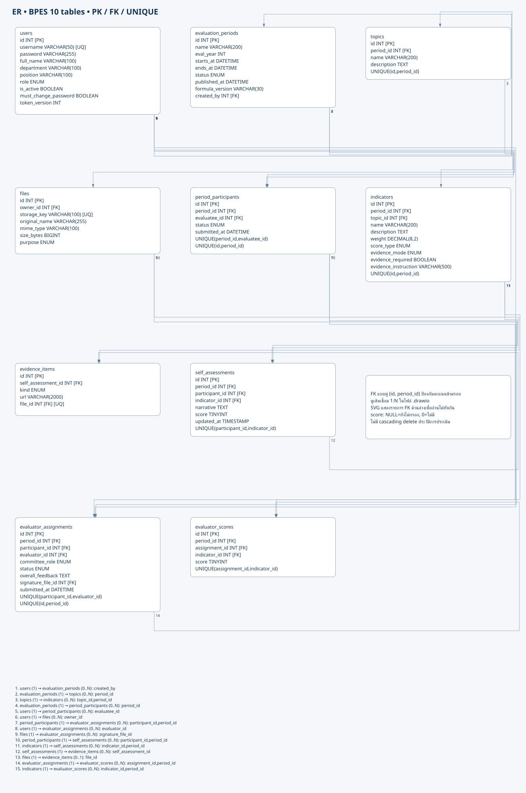

## 07-login-layout

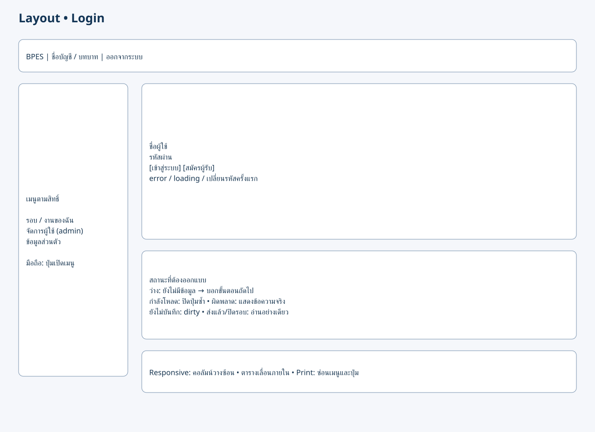

## 08-overview-layout

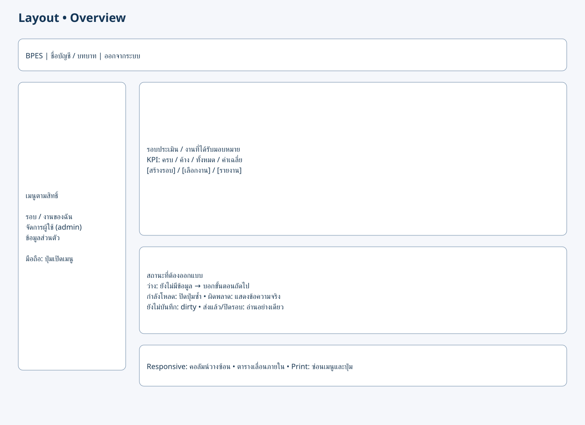

## 09-admin-layout

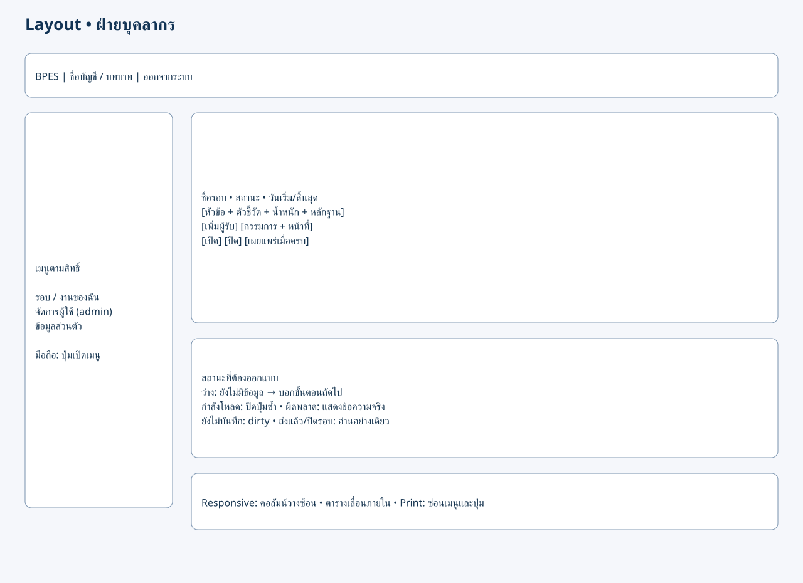

## 10-self-layout

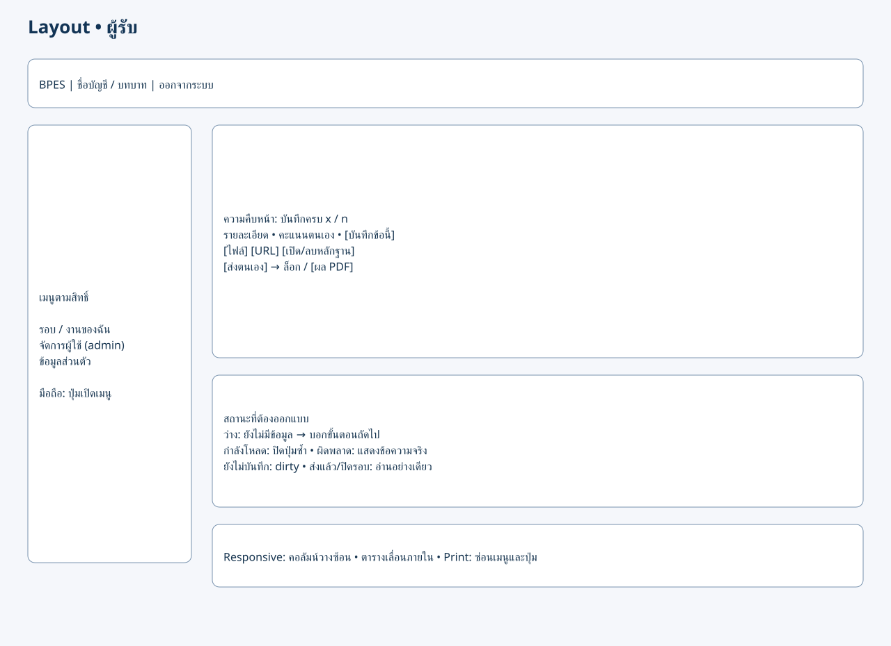

## 11-evaluator-layout

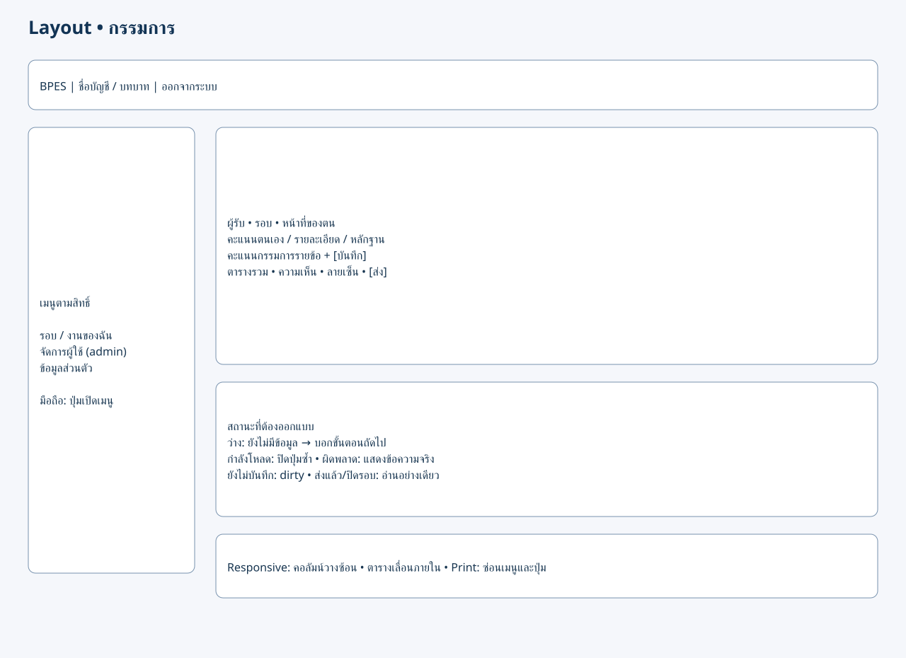

